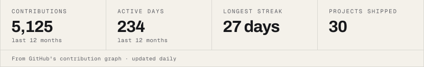
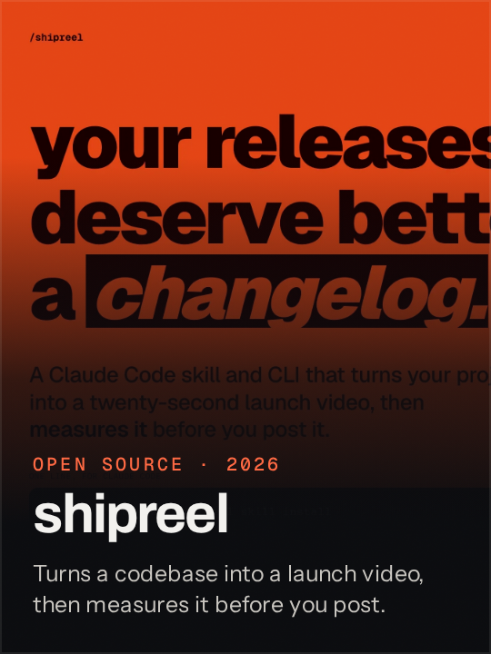
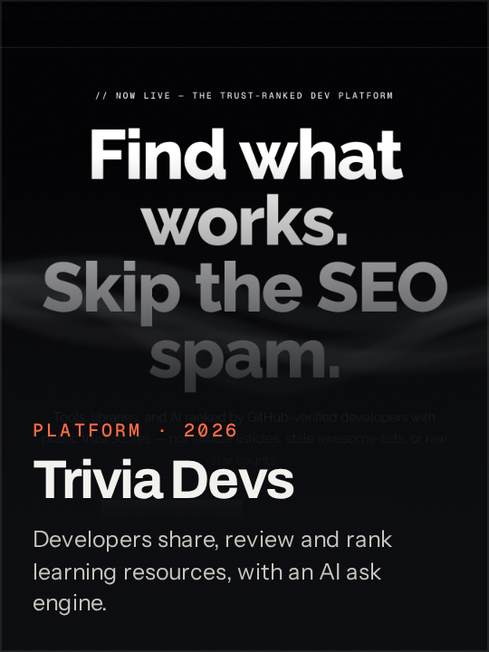
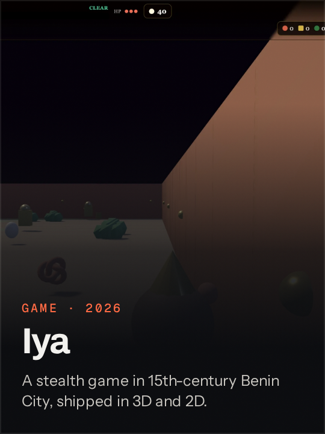
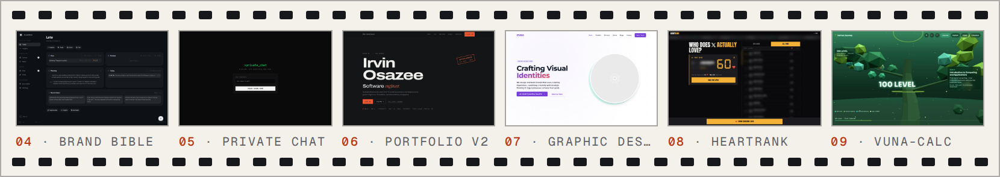
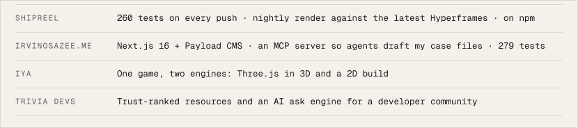

<!-- Generated by scripts/build.mjs. Edit the scripts, not this file. -->

<a href="https://www.irvinosazee.me"><picture><source media="(prefers-color-scheme: dark)" srcset="assets/slate-dark.svg"></picture></a> <a href="https://www.irvinosazee.me"><picture><source media="(prefers-color-scheme: dark)" srcset="assets/stats-dark.svg"></picture></a>

I build products end to end, then go the extra mile on the parts nobody asks for: the tests, the launch video, the tooling that keeps it honest.

## Now showing

  

## Dailies

<a href="https://www.irvinosazee.me/projects"><picture><source media="(prefers-color-scheme: dark)" srcset="assets/dailies-dark.png"></picture></a>

<!-- dailies:start -->
<a href="https://www.irvinosazee.me/projects/brand-bible">Brand Bible</a> · <a href="https://www.irvinosazee.me/projects/realtime-chat">Private Chat</a> · <a href="https://www.irvinosazee.me/projects/portfolio-v2">Portfolio v2</a> · <a href="https://www.irvinosazee.me/projects/graphic-design-agency-template">Graphic Design Agency Template</a> · <a href="https://www.irvinosazee.me/projects/heartrank">HeartRank</a> · <a href="https://www.irvinosazee.me/projects/vuna-calc">VUNA-Calc</a>
<!-- dailies:end -->

## Receipts

<picture><source media="(prefers-color-scheme: dark)" srcset="assets/receipts-dark.svg"></picture>

## On every set

<b>Frontend</b> 

<b>Backend</b> 

<b>Data</b> 

<b>Mobile</b> 

<b>Ship</b> 

<b>AI · Test</b> 

## Call sheet

<a href="https://www.irvinosazee.me/contact"><picture><source media="(prefers-color-scheme: dark)" srcset="assets/callsheet-dark.svg"></picture></a>

<a href="https://www.irvinosazee.me/contact"><picture><source media="(prefers-color-scheme: dark)" srcset="assets/button-hire-dark.svg"></picture></a>&nbsp;&nbsp;<a href="https://www.irvinosazee.me"><picture><source media="(prefers-color-scheme: dark)" srcset="assets/button-site-dark.svg"></picture></a>&nbsp;&nbsp;<a href="https://www.linkedin.com/in/irvin-osazee"><picture><source media="(prefers-color-scheme: dark)" srcset="assets/button-linkedin-dark.svg"></picture></a>

